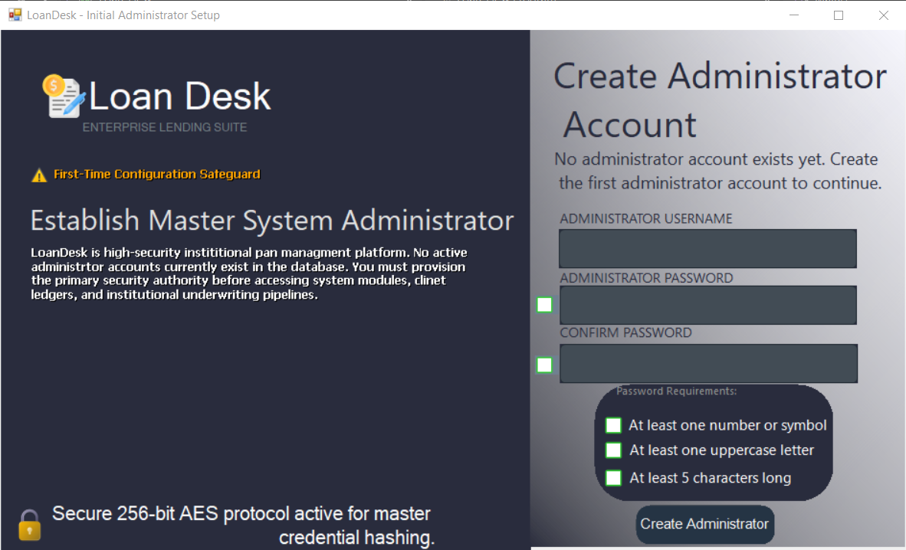
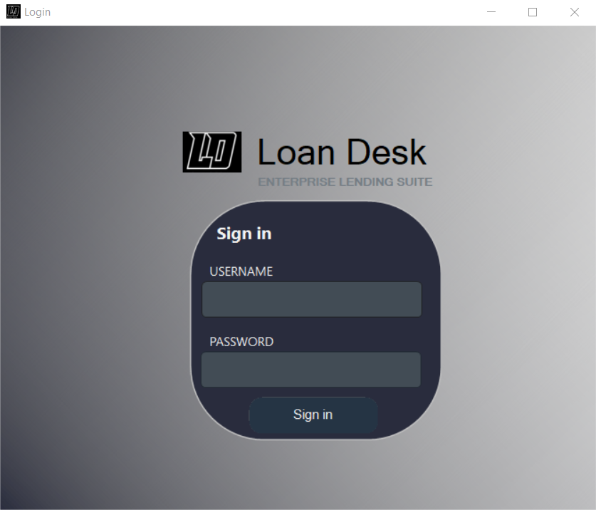
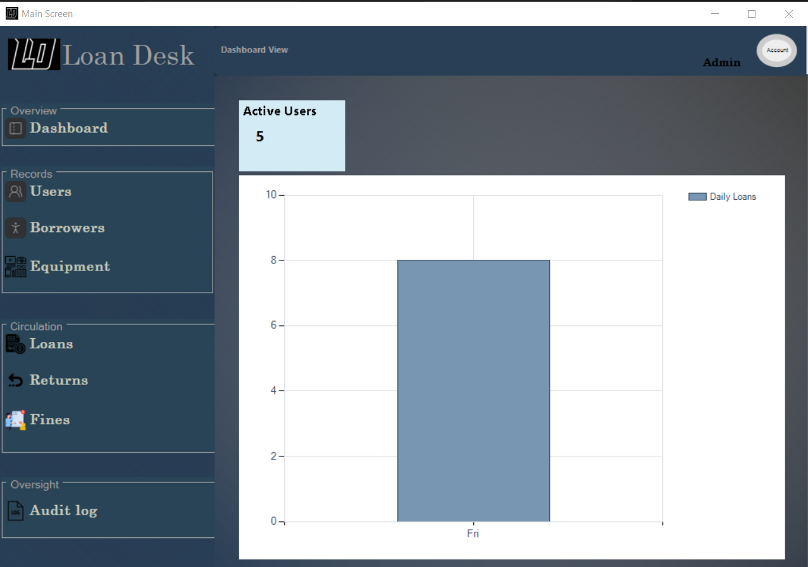
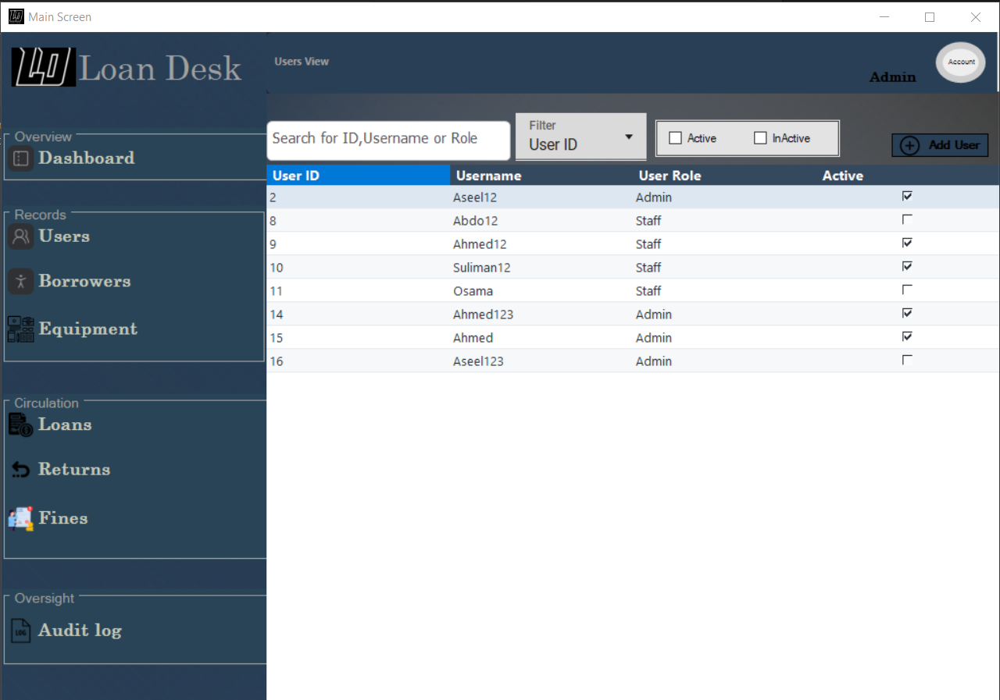
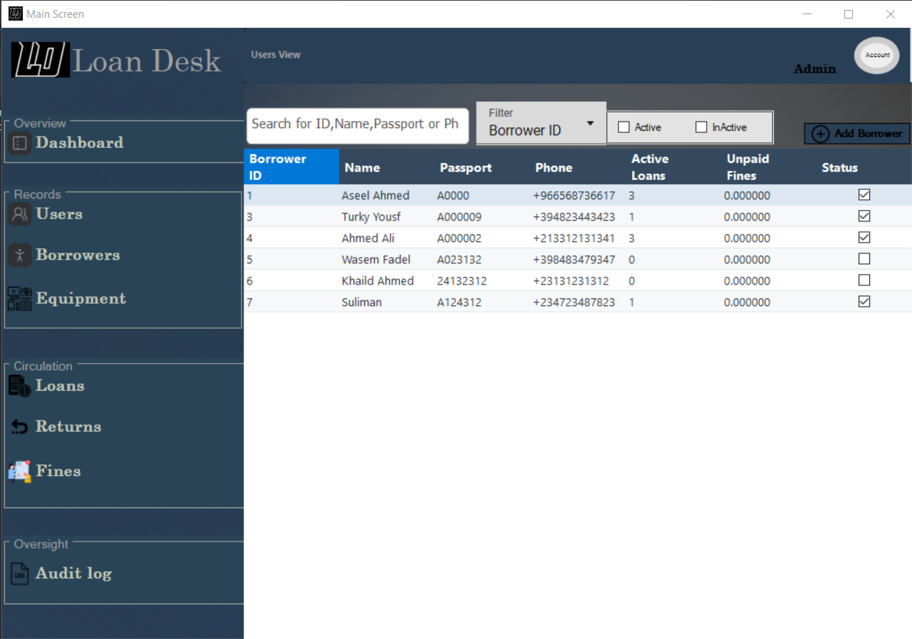
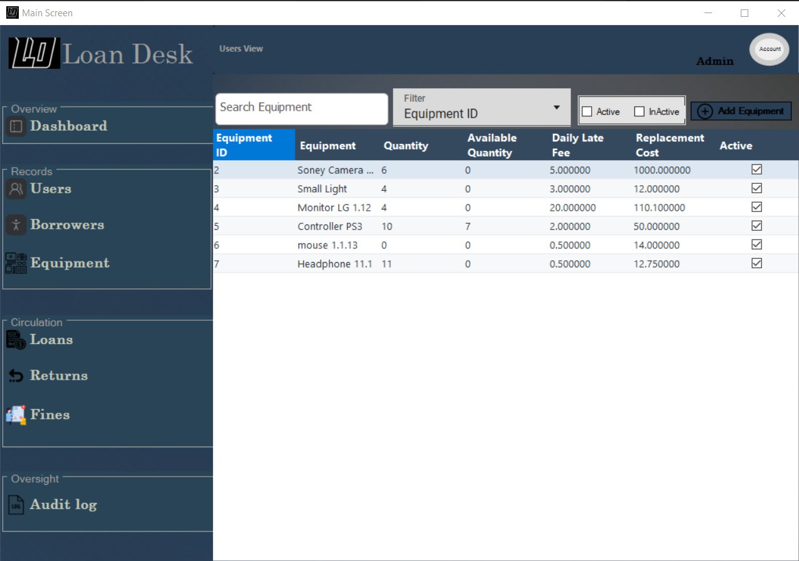
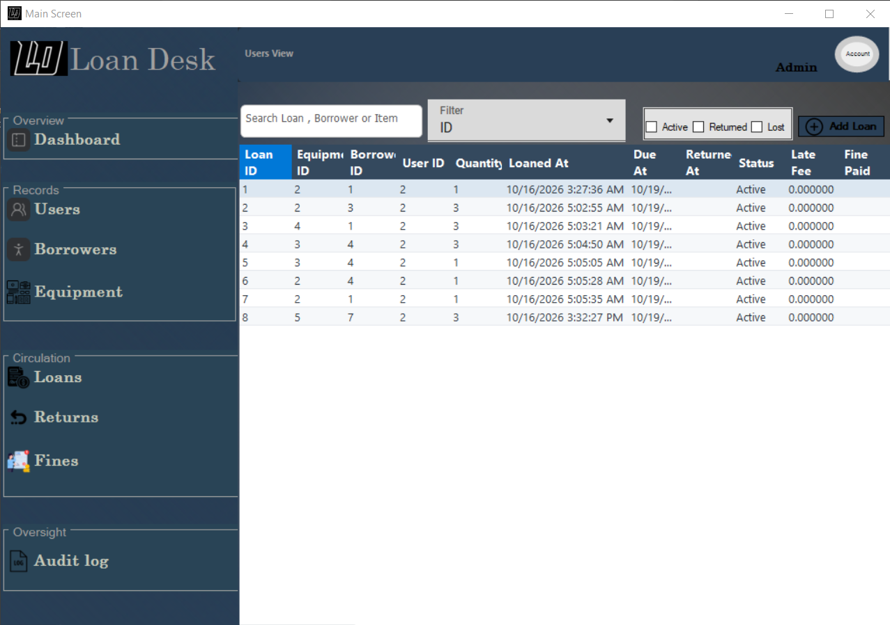
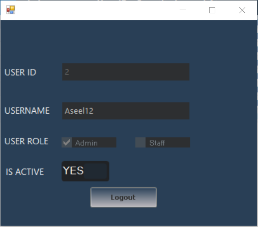

# LoanDesk

A campus equipment loan system built with C# and Windows Forms. It handles lending and returning things like laptops, projectors, and cameras, and keeps track of who has what, what's overdue, and who owes a fine.

> **Status:** Under development. Login, first-run setup, the dashboard, and the Users, Borrowers, Equipment, and Loans screens work. Returns, Fines, and the Audit Log are next.

I'm building this as a learning project. The goal isn't just a working app, it's getting the architecture right: a clean split between UI, business logic, and data access, with security built in from the start instead of patched on later.

---

## What it will do

- Manage users, borrowers, and equipment
- Check equipment out to borrowers and record returns
- Calculate and track fines for late returns
- Keep an audit log of important actions
- Role-based access (Admin and regular staff)

## Where things stand

**Working now**

- Login and first-run Admin account setup
- Password hashing with a random salt per user
- Session management
- Validation in the business layer
- Parameterized SQL queries everywhere
- Main window with navigation between sections
- Dashboard with active user count and a daily loans chart
- Users: list, search and filter, add, edit, and change password
- Borrowers: list, search and filter, add, and edit
- Equipment: list, search and filter, add, and edit
- Loans: list with search and filters (including dates and status), and creating a loan inside a database transaction
- Business rule: a borrower with an unpaid fine can't take a new loan
- Database script and an example config file

**In progress**

- Returns and Fines (the screens exist but are still empty)
- Audit logging (the table is there, the screen and logging aren't wired up yet)
- Role-based access control

**Planned**

- Database transaction for the return workflow (loans already use one)
- Better exception handling and logging
- Automated tests
- Better config management
- Reports
- UI polish

---

## Screenshots

Returns, Fines, and Audit Log are still being built, so they're not shown yet.

### Initial Administrator Setup



Shows up on first launch, only when the database has no admin account yet. You can't get past it until you create one. The password has to meet the listed requirements (a number or symbol, an uppercase letter, and at least 5 characters), and the checkboxes tick off as you type.

### Login



Plain sign-in screen with username and password. Credentials are checked in the business layer against the stored salted hash, and a successful login starts the user session.

### Dashboard



The main window. The sidebar is grouped into Overview, Records (Users, Borrowers, Equipment), Circulation (Loans, Returns, Fines), and Oversight (Audit Log). Clicking an item swaps the view in the main area. The dashboard itself shows the number of active users and a chart of daily loans.

### Users



A list of everyone who can use the system, with their role (Admin or Staff) and whether the account is active. You can search by ID, username, or role, filter by active or inactive, and add a new user.

### Borrowers



The people who borrow equipment. Each row shows name, passport number, phone, how many loans they currently have, and how much they owe in unpaid fines. Search works on ID, name, passport, or phone, and there's an active/inactive filter.

### Equipment



The inventory. Each item has a total quantity, how many are still available, a daily late fee, and a replacement cost (used if the item is lost). Same search and active/inactive filter as the other lists.

### Loans



Every loan with the equipment, borrower, staff member who handled it, quantity, loan date, due date, return date, status, late fee, and whether the fine was paid. You can search by loan, borrower, or item, and filter by Active, Returned, or Lost.

### My Account



Opens from the account button in the top right corner. Shows who is logged in (ID, username, role, active status) and has the Logout button.

---

## Architecture

Three layers, each one only talks to the layer below it:

```
Windows Forms UI
       ↓
Business Logic Layer (BLL)
       ↓
Data Access Layer (DAL)
       ↓
SQL Server
```

| Layer | What it does |
|-------|--------------|
| **UI** | Shows screens, takes input, displays results. No business rules here. |
| **BLL** | Validation, authentication, password handling, sessions, business rules. |
| **DAL** | Talks to SQL Server. Nothing else. |
| **Models** | The entities passed between layers (`User`, `Borrower`, `Equipment`, `Loan`). |

## Tech stack

- C# on .NET Framework 4.8
- Windows Forms (with the ReaLTaiizor UI library)
- SQL Server with ADO.NET
- Visual Studio

---

## Getting started

**You'll need**

- Windows
- Visual Studio with the .NET desktop development workload
- SQL Server (Express is fine)

**Steps**

1. Clone the repo:
   ```bash
   git clone https://github.com/Aseelcoding/Loan_Desk.git
   ```
2. Open `Loan_Desk.slnx` in Visual Studio.
3. Restore the NuGet packages (Visual Studio usually does this on build).
4. Create the database by running `Database/schema.sql` in SQL Server Management Studio. It creates a database called `LoanDeskDB` with all the tables.
5. Copy `App.config.example` to `App.config` and replace `YOUR_SERVER_NAME` in the connection string with your SQL Server instance name. `App.config` is in `.gitignore`, so your own settings won't get committed.
6. Build and run. On first launch you'll be asked to create the initial Admin account.

---

## Security

- Passwords are hashed with SHA-256 and a random salt per user, never stored in plain text
- All SQL goes through parameterized queries
- The current session can only be changed from the BLL (the setter is `internal`), so the UI can't touch it directly
- Validation lives in the BLL, not in the forms

**A note on password hashing:** salted SHA-256 is fine for a learning project, but it's too fast to be a good choice for real passwords. A production system should use a slow, purpose-built algorithm like PBKDF2, bcrypt, or Argon2. I'm keeping SHA-256 here on purpose to keep the project simple.

---

## Design decisions

A few problems I ran into and what I did about them.

**One form per section got messy.** Instead of a separate `Form` for every section, the main screen handles navigation and each section is a reusable `UserControl` (`UsersView`, `BorrowersView`, `EquipmentView`, `LoansView`, `ReturnsView`, `FinesView`, `AuditLogView`). Everything shows up inside one main window and each view owns its own logic.

**The UI shouldn't control the session.** If forms could modify the session directly, the UI would own application state. I restricted session changes with `internal`, so only the BLL can do it.

**Validation can't depend on the forms.** If rules live in the UI, they get copied across forms and drift apart. User validation runs in the BLL before anything reaches the DAL.

---

## Project structure

```
Loan_Desk
├── Login/            Login screen
├── Setup/            First-run Admin setup
├── Main Screen/      Main window and navigation
├── Users/            Users view
├── Borrowers/        Borrowers view
├── Equipment/        Equipment view
├── Loans/            Loans view
├── Returns/          Returns view
├── Fines/            Fines view
├── AuditLog/         Audit log view
├── Account/          My Account view (current user and logout)
├── Dashboard/        Active users and daily loans chart
├── Controls/         Shared custom controls (top info panel)
├── BLL/              Business logic (validation, hashing, sessions, logger)
├── DAL/              Database access
├── LoanDesk.Models/  Entities
├── utilities/        Shared helpers (e.g. DataGridView styling)
├── Database/         schema.sql to create the database
├── UI_Screenshots/   Screenshots used in this README
├── App.config.example
├── ErrorHandler.cs
└── Program.cs
```

---

## What I'm learning from this

- Keeping UI, logic, data access, and models separate
- When to use a `Form` and when a `UserControl` is the better fit
- Using access modifiers to protect application state
- Password hashing, salts, and parameterized queries
- Writing code that stays maintainable as it grows

## Author

**Aseel** ([@Aseelcoding](https://github.com/Aseelcoding))
